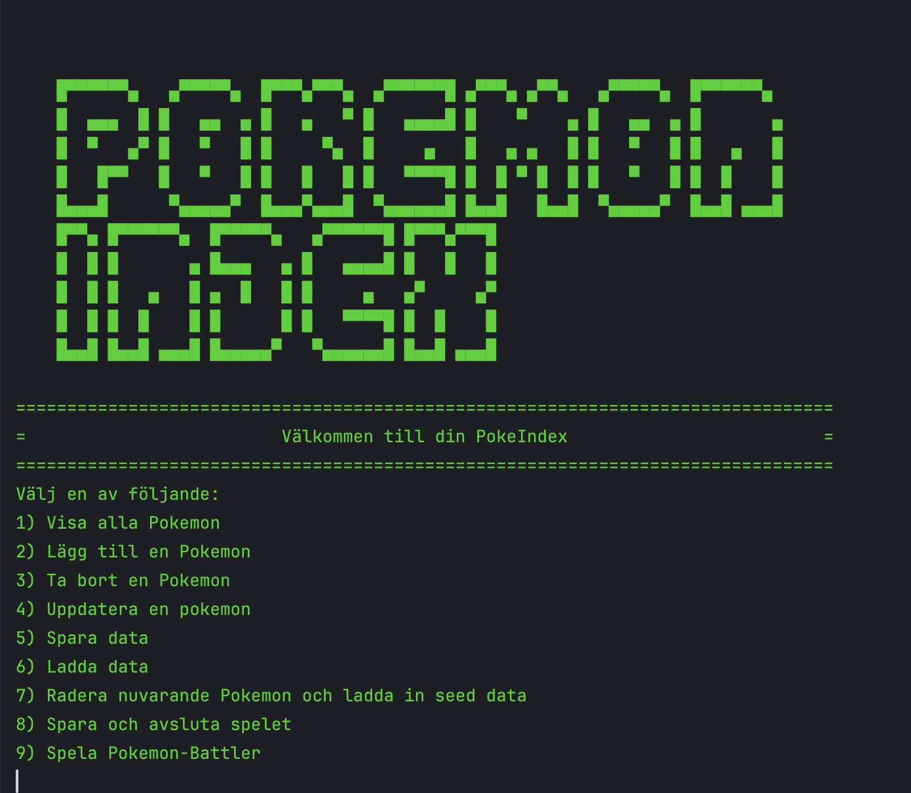
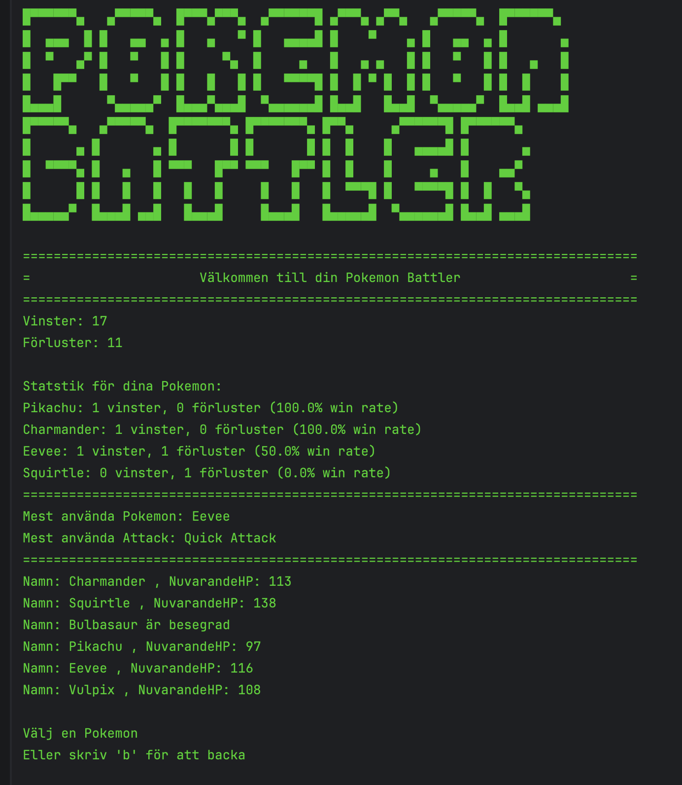

# PokeIndex

PokeIndex är min första inlämningsuppgift på JENSEN Yrkeshögskolas kurs
**Programmering med Java, grund**.

Programmet är en konsolbaserad Pokedex där användaren kan skapa och hantera Pokemon.
Data sparas i en JSON-fil med hjälp av Jackson.

## Funktioner

I programmet kan användaren:

- Visa alla Pokemon
- Lägga till en Pokemon
- Ta bort en Pokemon
- Uppdatera en Pokemon
- Uppdatera, lägga till och ta bort attacker
- Spara Pokemon till JSON
- Ladda Pokemon från JSON
- Återställa Pokedex till seed data
- Avsluta programmet och spara automatiskt

En Pokemon kan ha mellan 1 och 4 attacker.

## Användning

Navigera i huvudmenyn genom att skriva en siffra mellan 1-9 och trycka Enter.

Vissa menyval kräver ytterligare input. Om du till exempel vill ta bort en Pokemon
skriver du namnet på den Pokemon du vill ta bort.

## Data

Pokemon sparas i `Pokemons.json`.

Om det inte finns någon sparad Pokemon-data laddar programmet automatiskt in
fördefinierad seed data med 6 Pokemon.

## Tekniker

- Java
- Maven
- Jackson
- JSON
- ArrayList
- Enum
- Exceptions
- Egna Exceptions
- Filhantering
- Git och GitHub
# Pokemon Battler

Pokemon Battler är min andra inlämningsuppgift på JENSEN Yrkeshögskolas kurs **Programmering med Java, grund**.

Projektet bygger vidare på min tidigare inlämningsuppgift, PokeIndex.
I denna uppgift har jag vidareutvecklat programmet med ett turbaserat stridssystem där spelaren kan välja en Pokemon och slåss mot en datorstyrd motståndare.

Programmet använder JSON och Jackson för att spara Pokemon och stridsstatistik.

## Funktioner

### Pokemon Battler
- Välja Pokemon inför en strid
- Slåss mot en slumpmässigt vald CPU-Pokemon
- Avgöra vem som börjar genom tärningskast
- Välja attacker under striden
- CPU väljer attacker slumpmässigt
- Beräkna skada baserat på attackens styrka, slumpfaktor och typeffektivitet
- Hantera träffsäkerhet och missade attacker
- Hantera kritiska träffar
- Visa HP, rundor och stridsresultat
- Spara vinster och förluster
- Visa statistik för varje Pokemon
- Visa mest använda Pokemon och attack

## Hur man kör programmet

Projektet är byggt med Java och Maven.

1. Klona eller ladda ner projektet från GitHub.
2. Öppna projektet i IntelliJ IDEA.
3. Kontrollera att Maven dependencies har laddats.
4. Kör `Main.java`.
5. Programmet startar i konsolen.

## Användning

Programmet styrs genom konsolen där användaren navigerar mellan olika menyval.

I Pokédex kan användaren skapa och hantera sina Pokemon.

I Pokemon Battler visas stridsstatistiken innan spelaren väljer vilken Pokemon som ska användas.

Under striden väljer spelaren en attack genom att ange motsvarande nummer. Striden fortsätter tills någon av Pokemonen har 0 HP.

Programmet använder validering för att hantera ogiltiga inmatningar.

## Objektorienterad programmering (OOP)

Jag har refaktorerat min tidigare Pokédex och delat upp funktionaliteten i flera klasser med olika ansvarsområden.

### Inkapsling

Klasserna `Pokemon` och `Attack` innehåller privata fält som nås genom getters. Konstruktorerna validerar värden för att förhindra att ogiltiga objekt skapas.

### Interfaces och polymorfism

Jag använder interfacet `AttackSelector` för att hantera hur attacker väljs.

Två klasser implementerar interfacet:

- `PlayerAttackSelector` – spelaren väljer själv sin attack.
- `CPUAttackSelector` – datorn väljer en slumpmässig attack.

På detta sätt kan `BattleService` använda samma interface för båda spelarna utan att behöva känna till hur attacken väljs.

Jag använder även interfacet `GraphicsSelector` som implementeras
av klassen `Graphics` för att hantera programmets konsolutskrifter.

### Separation av ansvar

- `BattleService` – hanterar stridens flöde och turordning.
- `DamageCalculator` – hanterar skadeberäkning.
- `BattleStatistics` – hanterar statistik från strider.
- `FileHandler` – hanterar läsning och skrivning av JSON.
- `PokedexServices` – hanterar funktionaliteten i Pokédex.
- `ValidationService` – validerar användarens inmatning.
- `Pokemon` och `Attack` – representerar programmets objekt.

Denna uppdelning gör koden enklare att underhålla och vidareutveckla.

## Skadeberäkning

Skadan beräknas utifrån attackens grundskada, en slumpfaktor och typeffektivitet.

**Skada = Grundskada × Slumpfaktor × Typeffektivitet × Kritisk multiplikator**

- Slumpfaktor: 0,5–1,0
- Typeffektivitet: 0,5×, 1× eller 2×
- Kritisk träff: 1/16 chans att ge dubbel skada

Varje attack har även en träffsäkerhet som avgör om attacken träffar eller missar.

## VG-funktioner

Jag har implementerat följande VG-funktioner:

- Typeffektivitet mellan olika Pokemon-typer
- Kritiska träffar med slumpmässig chans
- JSON-persistens med Jackson
- Totala vinster och förluster
- Statistik över vinster, förluster och win rate per Pokemon
- Mest använda Pokemon
- Mest använda attack
- Statistik som sparas mellan programstarter
- Objektorienterad struktur med interfaces och polymorfism

## Data och filhantering

Programmet använder två JSON-filer:

- `src/main/resources/Pokemons.json` – sparar Pokemon och deras attacker.
- `src/main/resources/BattleStatistic.json` – sparar stridsstatistik.

Om statistikfilen saknas skapas tom statistik vid inläsning.

Programmet hanterar även ogiltig JSON genom felhantering så att det inte avslutas med ett ohanterat undantag vid inläsning.

## Felhantering

Programmet innehåller validering och felhantering för bland annat:

- Ogiltiga menyval och attacknummer
- Pokemon utan attacker
- Pokemon med 0 HP
- Saknade eller korrupta JSON-filer
- Avbruten användarinmatning
- Ogiltiga Pokemon-namn och typer

Jag använder även egna exceptions, bland annat `InvalidPokemonException` och `InvalidTypeException`.

## Kända begränsningar

- Programmet är konsolbaserat och saknar grafiskt användargränssnitt.
- Strider sker mellan en spelarstyrd Pokemon och en CPU-Pokemon åt gången.
- Statistik visas som vinster, förluster och win rate i procent.
- Om Pokemon-filen innehåller ogiltig data kan inläsningen misslyckas.

## Tekniker

- Java
- Maven
- Jackson
- JSON
- OOP och inkapsling
- Interfaces och polymorfism
- ArrayList och HashMap
- Enum
- Exceptions och egna exceptions
- Filhantering
- Git och GitHub
